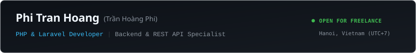

<div align="center">

  

  <br/><br/>

  <p align="center">
    <a href="https://github.com/phith752003">
      
    </a>
  </p>

  <p align="center">
    <a href="mailto:phith75@gmail.com"></a>
    
    
    
    
  </p>

</div>

---

### 📌 About Me

I am a **Backend Software Engineer** specializing in **PHP 8.x and the Laravel ecosystem**, with approximately 2 years of professional software development experience.

Currently, I work at **THK Holdings Vietnam**, where I develop and maintain production web applications and REST APIs for Japanese enterprise clients. Working in a Japanese enterprise environment has shaped my engineering approach: rigorous delivery standards, structured database design, clean asynchronous Git documentation, and thorough self-QA before submitting pull requests.

My core focus centers on building reliable backend systems:
- **RESTful API Development:** Designing intuitive, structured, and secure API contracts with Laravel Sanctum, Form Requests validation, and policy-based authorization.
- **Database & Query Optimization:** Eliminating costly N+1 query bottlenecks through eager loading (`with()`, `withCount()`), designing composite MySQL indexes, and profiling complex queries with `EXPLAIN`.
- **Caching & Background Queues:** Implementing in-memory Redis caching with explicit TTLs and cache-invalidation hooks for high-read master data; offloading heavy tasks to asynchronous Laravel Queues.
- **Reproducible Environments:** Containerizing multi-service development stacks (PHP-FPM, Nginx, MySQL, Redis) via Docker Compose to ensure local and staging environment parity.

Graduated with **Distinction** from **FPT Polytechnic College** (Cumulative GPA: **3.6 / 4.0**). Available for remote freelance contracts and backend development engagements via Upwork.

---

### 🛠️ Technical Stack

```
Backend Architecture     : PHP 8.x, Laravel (Eloquent, Sanctum, Queues & Jobs, Artisan), RESTful APIs, Composer
Database & Caching       : MySQL 8.x (Schema Design, Indexing, EXPLAIN Profiling), Redis
DevOps & Infrastructure  : Docker, Docker Compose, Linux (Ubuntu / WSL), Nginx, Git, GitHub, Postman
Testing & Code Quality   : PHPUnit (Feature & Unit Tests), Laravel Pint, PSR-12 Standard
Frontend Integration     : Vue.js 3 (Composition API, Pinia), JavaScript (ES6+), Blade, HTML5, CSS3, Tailwind CSS
```

<div align="left">

#### Backend & Core


#### Database & Caching


#### DevOps & Development Environment


#### Testing & Code Standards


#### Frontend (Integration Layer)


</div>

---

### 💼 Commercial Experience

#### **THK Holdings Vietnam**
**Software Engineer — PHP / Laravel Backend** · *Hanoi, Vietnam (Enterprise Client Projects)*  
*2025 – Present*

- **Production Engineering:** Developed and maintained backend services and REST APIs for Japanese enterprise systems, adhering to strict client quality protocols.
- **Query Optimization & Database Tuning:** Diagnosed and eliminated N+1 query bottlenecks using query logging and eager loading (`with()`); optimized heavy queries with composite indexes on high-frequency filter columns to lower endpoint latency.
- **Caching Architecture:** Configured Redis caching with explicit TTLs and cache-invalidation hooks for frequently queried master data tables, protecting primary MySQL instances from traffic spikes.
- **API Security & Contracts:** Engineered RESTful endpoints secured with Laravel Sanctum/JWT, custom Form Requests for data validation and sanitization, and Laravel Policies for authorization control.
- **Contract Documentation:** Authored and maintained complete Postman API collections with authentication headers, success/error payloads, and mock data for seamless handoffs to frontend and QA teams.
- **Environment Parity:** Containerized multi-service development stacks (PHP-FPM, Nginx, MySQL, Redis) with Docker Compose to eliminate "works on my machine" discrepancies between local setups and staging servers.
- **Enterprise Discipline:** Followed Japanese delivery expectations including comprehensive self-QA test runs before code review, clear asynchronous Git documentation, and zero-regression deployment routines.

---

### 🚀 Featured Projects

#### 1. Enterprise HR Management & Reporting Engine
> **Enterprise Production Module · THK Holdings Vietnam**  
> *Commercial case study demonstrating enterprise architecture, query optimization, and reporting workflows.*

- **Overview:** Enterprise backend system built to manage organizational structures, employee operational workflows, and heavy month-end data aggregation.
- **Tech Stack:** `PHP 8.2+` · `Laravel 12` · `MySQL` · `Redis` · `Docker Compose` · `PHPUnit` · `Scribe API Docs`
- **Verified Implementation Highlights:**
  - **Modular Architecture:** Structured API endpoints handling nested organizational department hierarchies, employee data, and attendance records.
  - **Optimized Reporting:** Eliminated slow query timeouts on month-end reports by replacing unindexed queries with Eloquent relationships pre-loading aggregates (`withCount`, eager joins) and composite database indexes.
  - **In-Memory Caching:** Integrated Redis caching for read-heavy master data and department trees, significantly reducing relational query load.
  - **Containerized Stack:** Docker Compose configuration maintaining environment parity across PHP-FPM, Nginx, MySQL, and Redis services.
  - **Regression Safety:** Built automated PHPUnit feature tests verifying critical endpoint payloads, HTTP status codes, and input validation boundaries.
*(Note: Proprietary enterprise project; source code is private, architecture and technical implementation verified through production delivery).*

---

#### 2. Exclusive — Library & Book Management REST API Platform
> **Full-Stack Application** · [Repository on GitHub](https://github.com/phith75/Exclusive)  
> *Comprehensive RESTful backend accompanied by Vue 3 admin and client interfaces.*

- **Overview:** A complete web application providing a versioned Laravel 10 REST API paired with Vue 3 administrative and customer dashboards for book cataloging, circulation tracking, and user management.
- **Tech Stack:** `PHP 8.1+` · `Laravel 10` · `MySQL` · `JWT Auth` · `Vue.js 3` · `Pinia` · `PHPUnit` · `Laravel Pint`
- **Verified Implementation Highlights:**
  - **Versioned API Structure:** Clean RESTful architecture organized with distinct route namespaces and controllers for administrative (`/api/v1/admin`) and client (`/api/v1/client`) operations.
  - **Authentication & Permissions:** Token-based authentication using JWT (`tymon/jwt-auth`) with middleware guards protecting sensitive admin routes.
  - **Soft-Delete Lifecycle:** Implemented full soft-delete management (`getTrashed`, restore, hardDelete) across authors, publishers, categories, books, and users.
  - **Excel Import/Export:** Integrated `Maatwebsite/Laravel-Excel` for structured catalog data exports and reporting.
  - **Code Quality:** Automated style compliance via `Laravel Pint` and endpoint test coverage via `PHPUnit`.

---

#### 3. High-Performance URL Shortener & Analytics API
> **Backend Architecture Project** · *Dockerized CQRS & Caching Implementation*

- **Overview:** A specialized backend service engineered for high-throughput link redirection, analytics tracking, and dynamic QR code generation, demonstrating read-write database splitting and in-memory caching.
- **Tech Stack:** `PHP 8.1+` · `Laravel 10` · `MySQL 8 (Master/Replica CQRS)` · `Redis 7` · `Docker Compose` · `Nginx`
- **Verified Implementation Highlights:**
  - **Multi-Container Infrastructure:** Docker Compose setup orchestrating PHP-FPM, Nginx Alpine, separated MySQL 8 Write and Read replica instances, and Redis 7.
  - **CQRS Read/Write Splitting:** Configured database connections directing write requests (`DB_HOST_WRITE`) to the master database while reading redirects and statistics through the replica and Redis cache.
  - **Clean Domain Separation:** Built using Repository and Service design patterns (`app/Repositories`, `app/Services`) ensuring testable and decoupled business logic.
  - **Event-Driven Workflows:** Utilized `spatie/laravel-event-sourcing` to capture click telemetry and event streams asynchronously.
  - **Dynamic Utilities:** Integrated automated on-the-fly QR code generation (`simple-qrcode`) for shortened URLs.

---

#### 4. Cinema Ticket Booking & Seat Reservation System (Capstone)
> **Full-Stack Graduation Capstone** · [Frontend Repo (DATN_FE)](https://github.com/phith752003/DATN_FE) · [Backend API Repo (PRO224)](https://github.com/phith75/PRO224_phithph22381)  
> *End-to-end cinema reservation platform with concurrent seat reservation locking and payment integrations.*

- **Overview:** Full-scale cinema management platform featuring real-time seat reservation locking, film schedules, payment gateway callbacks, and automated ticket dispatch.
- **Tech Stack:** `PHP 8.x` · `Laravel` · `MySQL` · `React 18` · `TypeScript` · `Vite` · `Laravel Sanctum` · `VNPay / MoMo`
- **Verified Implementation Highlights:**
  - **Concurrency Control:** Engineered seat caching mechanism (`cache_seat`) to lock reserved seats temporarily during checkout, preventing double-booking race conditions.
  - **Payment Gateways:** Integrated automated payment workflows with VNPay and MoMo, handling asynchronous IPN callbacks and status reconciliation.
  - **Operational Management:** RESTful CRUD services for cinema halls, showtime matrixes, voucher discounts, and revenue aggregation by cinema branch.
  - **Ticket Dispatch:** Automated email confirmations generating dynamic QR ticket tokens for physical scanner validation.

---

### ⚙️ Engineering Principles

- **Maintainability Over Cleverness:** Write readable, predictable PHP adhering strictly to PSR-12 and modern Laravel idioms. Keep controllers thin by encapsulating validation in Form Requests, business workflows in Services, and authorization in Policies.
- **Performance by Design:** Treat database queries as first-class citizens. Profile query execution with `EXPLAIN`, prevent N+1 query execution through deliberate eager loading, design indexes for filtered columns, and apply Redis caching with unambiguous invalidation logic.
- **Reliability & Contract Integrity:** Protect critical paths with automated PHPUnit feature tests. Document unambiguous API contracts in Postman—complete with sample payloads, status codes, and error responses—to ensure seamless frontend and client integration.
- **Pragmatic Delivery:** Avoid unnecessary complexity and architectural over-engineering. Deliver clean, containerized code that is easy to deploy, simple to test, and maintainable over the long term.

---

### 🎓 Education

#### **FPT Polytechnic College**
**Associate Degree in Information Technology — Web Development**  
*Hanoi, Vietnam · 2021 – 2024*

- **Academic Standing:** Graduated with **Distinction** (Cumulative GPA: **3.6 / 4.0**)
- **Core Coursework:** Object-Oriented Programming (OOP), Relational Database Design & Normalization, Data Structures & Algorithms, Web Application Architecture, Software Development Lifecycle.

---

### 🤝 Freelance Services & Direct Contact

I am open to remote freelance contracts and backend development engagements on **Upwork**:

- **New REST API & Backend Development:** Building scalable, secure Laravel APIs from ground up for web and mobile frontends.
- **Application Refactoring & Optimization:** Diagnosing slow MySQL queries, eliminating N+1 bottlenecks, setting up Redis caching, and restructuring legacy PHP code.
- **Feature Development & Maintenance:** Adding new business modules, role-based authorization, or third-party integrations to existing Laravel codebases.
- **Payment & Third-Party Integrations:** Integrating payment providers (Stripe, PayPal, VNPay, MoMo), email dispatchers, and external APIs.
- **Docker Environment Setup:** Containerizing existing PHP/Laravel applications with Docker Compose for smooth onboarding and deployment.

<div align="left">

- 📬 **Direct Email:** [phith75@gmail.com](mailto:phith75@gmail.com)
- 💼 **GitHub:** [github.com/phith752003](https://github.com/phith752003)
- 🌐 **Timezone:** Hanoi, Vietnam (UTC+7) — Flexible for asynchronous communication across US, European, and APAC timezones.

</div>
